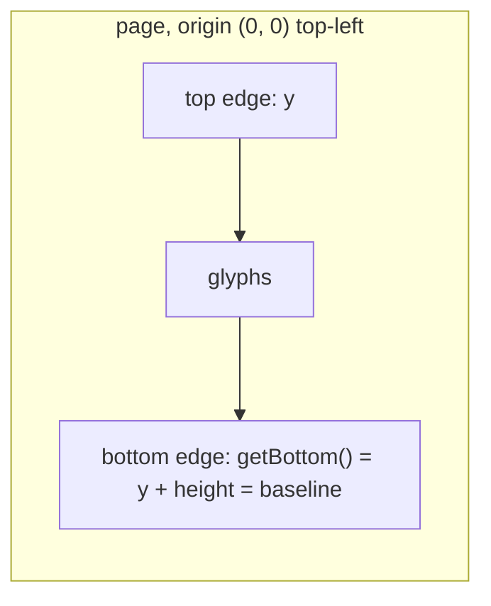
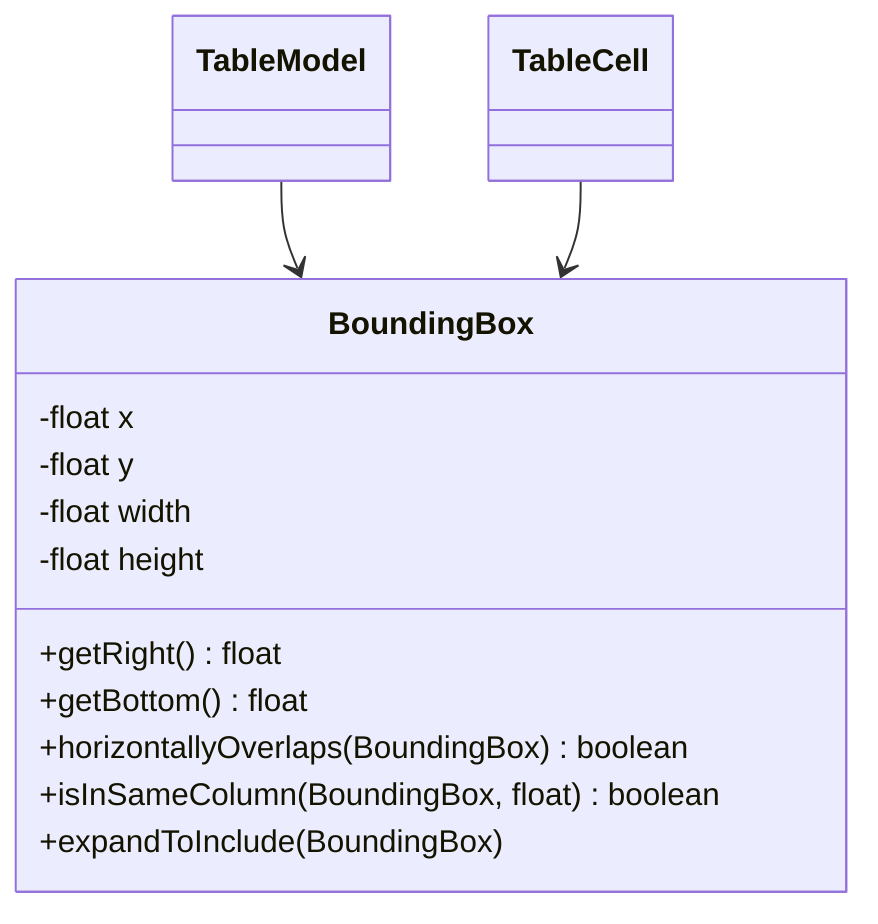
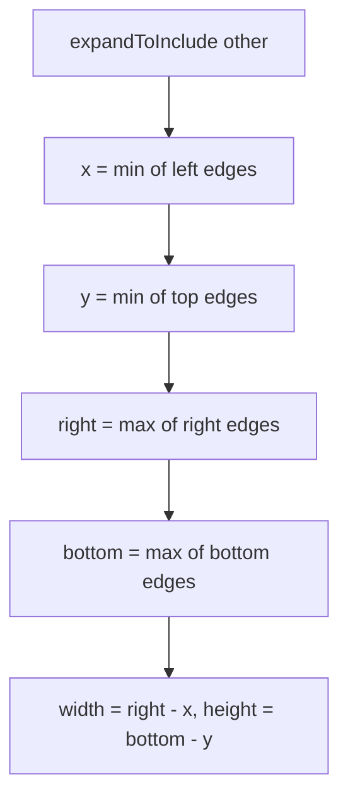

# BoundingBox

Axis-aligned rectangle used for table and cell geometry (`TableModel`, `TableCell`). It is
serialized to JSON with Jackson as `x`, `y`, `width`, `height`.

## Coordinate convention

Decided in issue #172:

- Units are PDF points (1/72 inch)
- The origin is the **top-left** corner of the page (media box), the same space as PDFBox
  `TextPosition.getX` / `getY`
- `x` grows to the right, `y` grows **downward**
- `y` is the **top edge** of the box and `getBottom()` (`y + height`) the bottom edge
- `y` is not the text baseline; for text the box spans `baseline - height .. baseline`

## Skewed text

The box has no angle. For text at a non-right angle it is the axis-aligned envelope of the turned
cell rectangle (issue #208): it covers the glyphs of the cell, but boxes of neighbouring cells may
overlap and contain glyphs of each other. `horizontallyOverlaps` and `isInSameColumn` are therefore
not reliable for skewed tables, the row and column indices of `TableCell` are.

## Structure

## Flow

