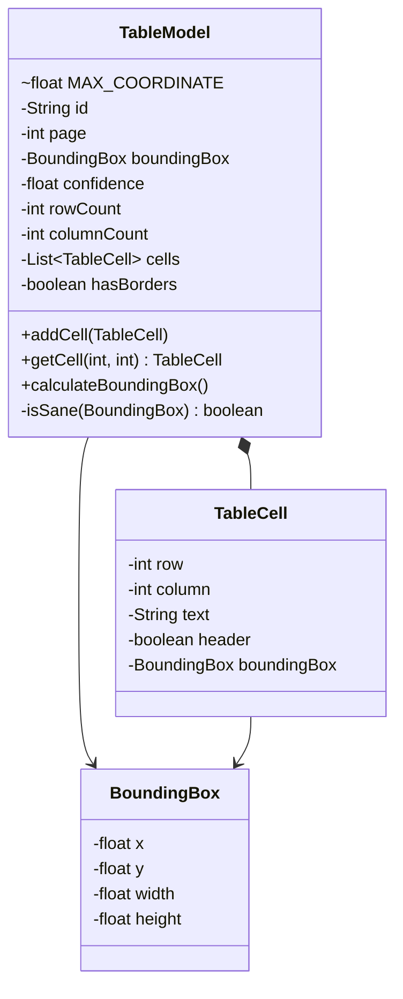
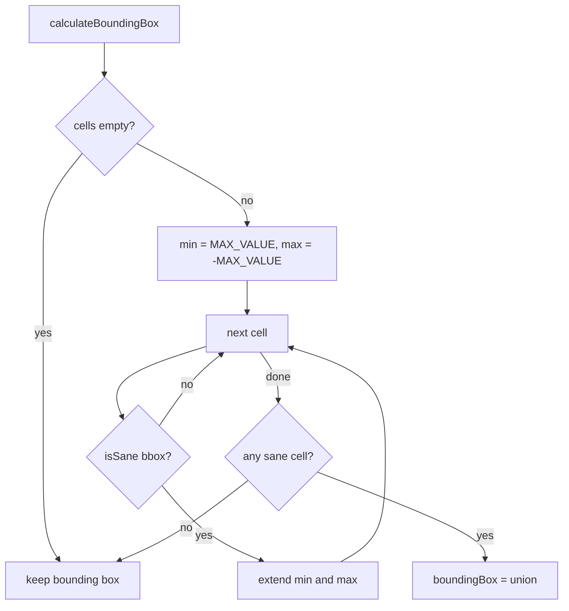

# TableModel

Data model of one detected table: id, page, confidence, row and column count, border flag, the
list of `TableCell`s and the table `BoundingBox`. It is serialized to JSON with Jackson and shared
by all detectors (`table-detector-pdf`) and consumers (`vim-parser-table` in the portunix-vim repository).

All bounding boxes use the `BoundingBox` convention (issue #172): PDF points, origin in the
top-left corner of the page, `y` grows downward and is the top edge of the box, not the text
baseline. See [BoundingBox.md](BoundingBox.md).

`calculateBoundingBox` sets the table bounding box to the union of the cell bounding boxes. As a
guard (issue #164) it skips a cell whose bounding box is missing, not finite, or reaches beyond
`MAX_COORDINATE` (14400 pt, the largest PDF user space: 200 inches × 72), so one bad cell cannot
spread the table. When no cell is usable, the bounding box stays unset.

Known limit: pages that use `UserUnit` or a media box larger than 14400 pt have real coordinates
beyond `MAX_COORDINATE`, so their cells are skipped and the table gets no bounding box.

## Structure

## Flow

