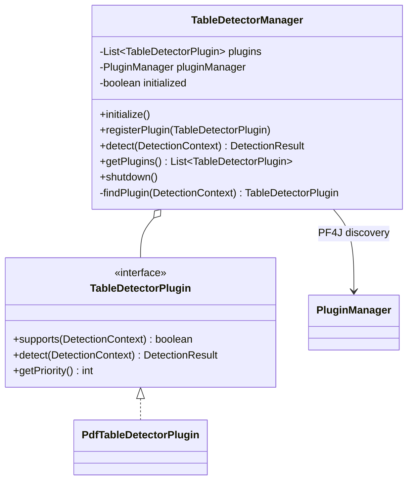
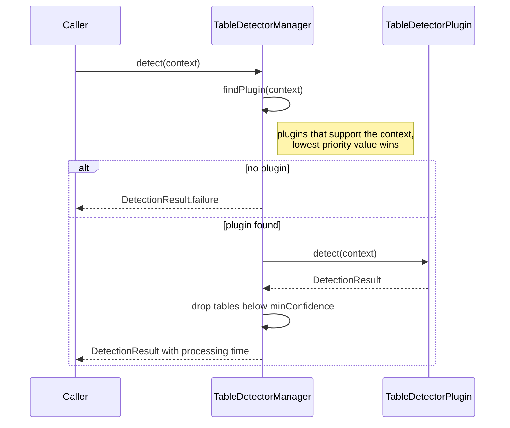

# TableDetectorManager

Holds the table detection backends (`TableDetectorPlugin`) and routes each detection request to
the one that supports the input. Backends come from PF4J discovery (`initialize()`) or from
manual registration (`registerPlugin()`), the CLI `Main` and embedded users such as
text-extractor register `PdfTableDetectorPlugin` directly.

## Structure

## Detection flow

## Logging

The logger comes from `LogFactory.getLogger` (`java.util.logging`). Messages use
`MessageFormat` placeholders `{0}`, `{1}`; SLF4J style `{}` is not substituted.

- `FINE`: number of plugins found by PF4J discovery
- `WARNING`: PF4J discovery failed, the manager continues with manually registered plugins
- `FINER`: each manually registered plugin
