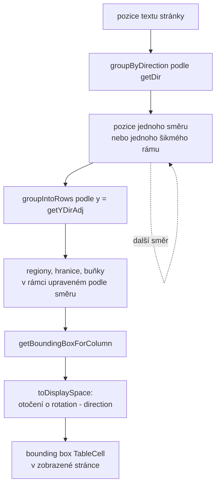
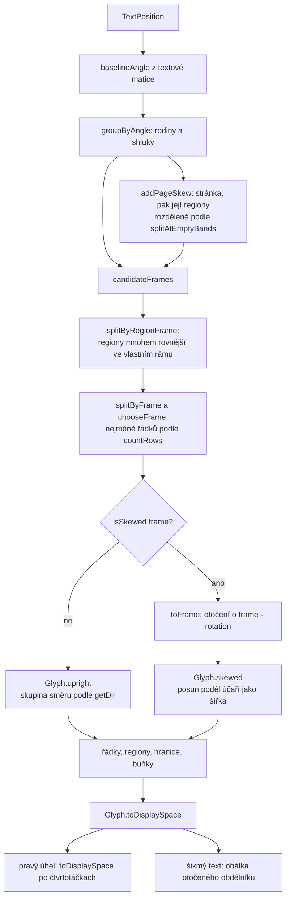
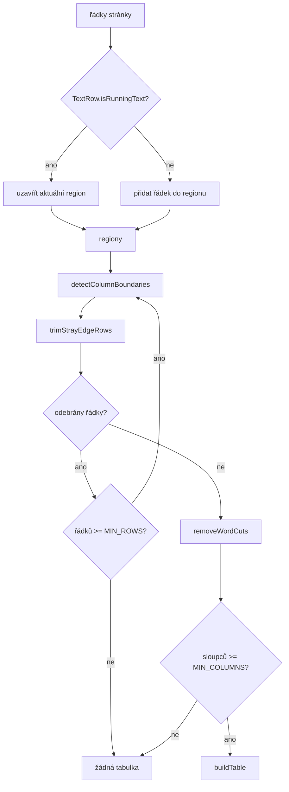
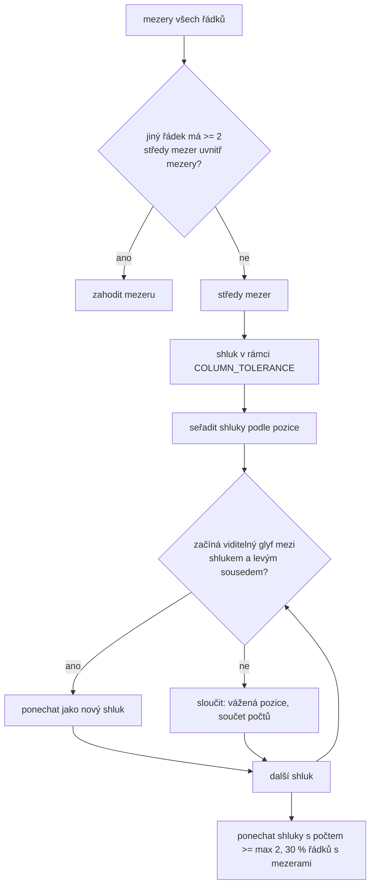
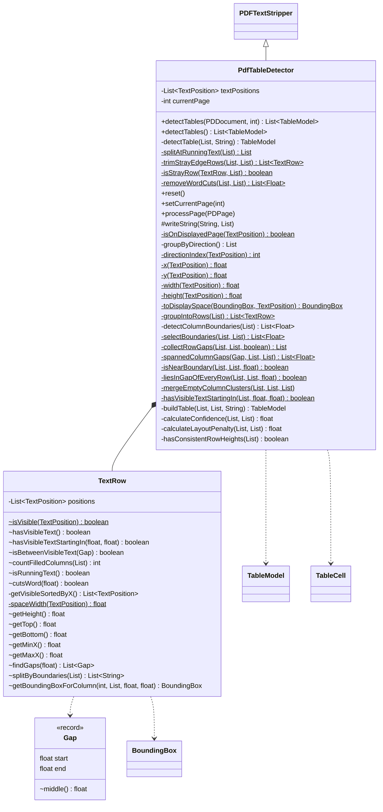
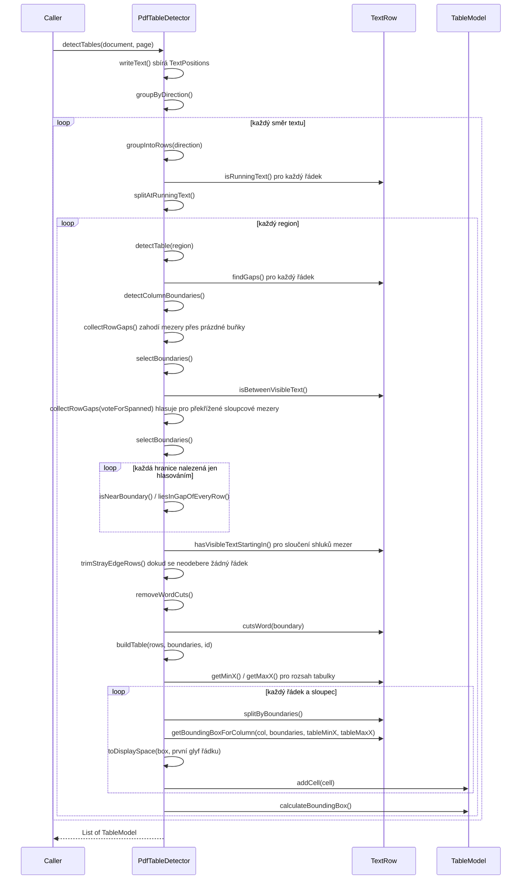

# PdfTableDetector

Detekuje tabulky bez ohraničení na stránce PDF podle pozic textu. Rozšiřuje PDFBox
`PDFTextStripper`, sbírá všechny `TextPosition` stránky a pro každou tabulku nalezenou
heuristikami rozvržení sestaví `TableModel`:

1. Pozice textu se seskupí podle směru textu, každý směr se prohledá zvlášť ve svém rámci
   upraveném podle směru; šikmý text dostane jednu skupinu na úhel rámu (viz níže)
2. Pozice textu se seskupí do řádků podle souřadnice Y (tolerance 3 pt)
3. Řádky běžného textu rozdělí stránku na regiony, v každém regionu se hledá jedna tabulka (viz
   níže)
4. Mezery širší než `GAP_THRESHOLD` × průměrná šířka glyfu jsou kandidáti na sloupcové mezery,
   mezera přes prázdnou buňku se zahodí (viz níže)
5. Středy mezer se shlukují (`COLUMN_TOLERANCE`), sousední shluky, mezi kterými nezačíná žádný
   viditelný glyf, se sloučí (viz níže); shluk nalezený alespoň ve 30 % řádků s mezerami (a
   alespoň dvakrát) se stane hranicí sloupce
6. Zbloudilé řádky na okrajích regionu se oříznou a hranice uvnitř slova se odstraní (viz níže)
7. Každý řádek se podle hranic rozdělí na buňky; první řádek je záhlaví
8. Confidence se počítá z počtu řádků a sloupců a konzistence výšky řádků, minus penalizace za
   layoutovou tabulku (mnoho řádků, mnoho prázdných buněk, dlouhé věty)

Používá ho samostatný plugin `table-detector` a `vim-parser-table` (repozitář portunix-vim), který tento JAR přibaluje.

## Směr textu a otočené stránky

`TextPosition.getX` / `getY` / `getWidth` / `getHeight` se udávají v zobrazené stránce, po
otočení `/Rotate`. Na otočené stránce v ní text tabulky běží svisle, seskupení podle `getY`
udělalo z každého sloupce glyfů řádek a z mezer mezi slovy hranice sloupců (issue #173). Veškerá
geometrie proto jde přes pomocné metody `x`, `y`, `width` a `height`, které vracejí hodnoty
upravené podle směru (`getXDirAdj`, `getYDirAdj`, `getWidthDirAdj`, `getHeightDir`). V tomto
rámci běží text zleva doprava a y roste dolů, bez ohledu na otočení stránky a textovou matici. Pro
vzpřímený text na neotočené stránce jsou obě sady hodnot stejné.

- `groupByDirection` rozdělí pozice textu podle `TextPosition.getDir` (`directionIndex`, čtvrtotáčky
  0 až 3) a `detectTables` spustí seskupení do řádků a hledání regionů pro každý směr, 0° první.
  Popisek otočený o 90° na okraji vodorovné tabulky pak nepřidá glyfy do jejích řádků a id tabulek
  pokračují napříč směry
- `toDisplaySpace` otočí každý box buňky zpět do zobrazené stránky, souřadnicového systému
  `BoundingBox`. Rámec směru `d` je media box (`getPageWidth` × `getPageHeight`, prohozené pro 90°
  a 270°) a do zobrazené stránky se otočí po směru hodinových ručiček o `(getRotation − d) mod 360`:

| Otočení | Zobrazený box pro `(x, y, w, h)` v rámci `W` × `H` |
| ------- | -------------------------------------------------- |
| 0 | `(x, y, w, h)` |
| 1 (90°) | `(H − y − h, x, h, w)` |
| 2 (180°) | `(W − x − w, H − y − h, w, h)` |
| 3 (270°) | `(y, W − x − w, h, w)` |

Bounding box tabulky je sjednocením zobrazených boxů buněk, takže je také v zobrazené stránce.

PDFBox hlásí i text mimo crop box, se souřadnicemi za zobrazenou stránkou. Prohlížeče ho
nezobrazují, takže skrytý sloupec by přidal sloupec do tabulky. `writeString` si glyf ponechá, když
alespoň část jeho boxu leží na zobrazené stránce (`isOnDisplayedPage`). Box glyfu vzniká v rámci
směru textu a otáčí ho `toDisplaySpace`, protože `getWidth` a `getHeight` směr textu nesledují.

- Buňka přes okraj stránky obsahuje jen glyfy, které jsou alespoň částečně vidět, text je uříznutý
  jako v prohlížeči (`Truncated0` se změní na `Trun`).
- Ponechaný glyf může začínat vlevo od stránky, jeho x tedy může být záporné a první zarážka
  sloupců je `-Float.MAX_VALUE`, ne `0`. Box buňky pak o tento přesah sahá za okraj stránky.
- PDFBox ořízne crop box podle media boxu, což u nulového crop boxu nebo u crop boxu mimo media box
  dá prázdný box, i když prohlížeče stránku zobrazí. `processPage` pak po dobu zpracování použije
  media box a deklarovaný crop box potom vrátí.

## Šikmý text

`TextPosition.getDir` vrací jen 0, 90, 180 nebo 270. Text pod 30° spadl do směru 0, jeho účaří podél
řádku stoupalo, takže buňky jednoho řádku skončily v různých řádcích a sloupcích, a
`getWidthDirAdj` se zkrátil o `cos 30°` (issue #208). Typickým zdrojem jsou OCR vrstvy šikmých
skenů a výkresy s otočeným rohovým razítkem.

- `baselineAngle` čte skutečný úhel z matice vykreslení textu, `atan2(shearY, scaleX)`. Matice
  neobsahuje `/Rotate` stránky. Zkosení podél účaří (kurzíva) úhel nemění
- `groupByAngle` seřadí pozice textu podle úhlu a novou skupinu začne tam, kde se sousedé liší o danou
  mezeru nebo více. Úhly jsou kruhové, takže skupiny na obou koncích rozsahu se spojí, když je krok
  přes 0° menší. `ANGLE_GAP` (1°) dává **rodiny**, `ANGLE_STEP` (0,15°) **shluky** uvnitř rodiny
- Úhel glyfu rám jen navrhuje, **rozhoduje poloha textu**. OCR vrstva může na šikmé stránce zapsat
  přesné úhly, na vzpřímené mřížce úhly se šumem a dokonce blok přesně pod 0° na stránce sklopené
  o 1,5°. `candidateFrames` nabízí pravé úhly, průměry rodin a průměry shluků s `FRAME_MIN_SHARE`
  (10 %) stránky, každý rám s počtem glyfů, které ho podporují
- `straightestFrame` opraví rám rodiny nebo shluku s tímto podílem: v rozsahu `FRAME_SEARCH_RANGE`
  (±1,5°) po `FRAME_SEARCH_STEP` (0,1°) hledá nejméně řádků dané skupiny, při shodě zůstane nejbližší
  úhel a nejbližší pravý úhel vyhraje, když nedá víc řádků
- `addPageSkew` hledá natočení stránky jen z poloh, některé OCR vrstvy zapíší úhly bez jeho stopy
  (issue #211). Pro glyfy do `PAGE_SKEW_RANGE` (±5°) od pravého úhlu hledá po `FRAME_SEARCH_STEP`
  nejméně řádků, a to na nejvýše `PAGE_SKEW_MAX_GLYPHS` (2000) rovnoměrně vybraných glyfech. Krátké
  řádky zůstanou rovné v celém rozsahu úhlů, proto bere jeho střed. Úhel nabídne, jen když zbude
  nejvýše `PAGE_SKEW_MAX_ROWS` (75 %) řádků pravého úhlu, stránka se vzpřímenou a 2° tabulkou
  nezíská žádným z obou rámů. Celá stránka jen navrhuje: každá rodina dál vybírá rám podle vlastních
  řádků, takže tabulka rovná ve svém úhlu si ho ponechá. Nabídnutý rám vyhrává každou shodu a nahradí
  šikmé rámy bližší než `PAGE_SKEW_SAME_FRAME` (0,25°), takže rodina příliš malá na to, aby natočení
  ukázala, se připojí ke zbytku stránky
- **Regiony** řeší tabulky s různým natočením, které OCR vrstva zapíše pod jedním úhlem, celá stránka
  tam žádným z rámů nezíská (issue #213). `splitAtEmptyBands` rozdělí text v pásech širších než
  `REGION_MIN_GAP` (40 pt) napříč řádky pravého úhlu, ještě než je známý rám. Při alespoň dvou
  regionech s `REGION_MIN_ROWS` (4) řádky `addPageSkew` prohledá každý zvlášť a nabídne jeho natočení.
  Rozhoduje `isFarStraighter`: v tomto rámu alespoň `REGION_MIN_ROWS` řádků a nejvýše
  `REGION_MAX_ROWS` (40 %) řádků dosud nejlepšího rámu. Mez je přísnější než u stránky, dva sloupce
  s posunutým účařím se při nějakém úhlu srovnají a řádky se zmenší na polovinu, šikmá tabulka se třemi
  a více sloupci klesne na třetinu. Při `REGION_MIN_COLUMNS` (3) sloupcích v rámu, počítaných jako
  prázdné pásy napříč ním, stačí `REGION_MAX_ROWS_COLUMNS` (50 %): sloupce skutečné tabulky mohou padnout
  na sousední řádky a jen se spárují (issue #215). Do laťky se nepočítá natočení stránky, kompromis mezi
  dvěma tabulkami, rámy, které mu ustoupily, ani rámy dál než 45° od pravého úhlu, které počítají šířku textu, ne řádky. Tabulka
  rozdělená pásem nic nezíská a zůstane v jednom rámu
- `splitByRegionFrame` vyjme z rodiny regiony, které projdou `isFarStraighter`, každý je pro
  `splitByFrame` samostatnou částí a zbytek zůstane pohromadě. Rodina bez takového regionu jde stejnou
  cestou jako dříve, takže stránka, která nic nezíská, si ponechá svůj výsledek
- `countRows` počítá řádky počátků glyfů v rámu: počátky vzdálené víc než `ROW_GAP` (0,75 pt) začínají
  nový řádek a řádek vyšší než `ROW_TOLERANCE` se počítá jednou na každé 3 pt výšky, protože řádky
  křížící řádky rámu se slijí do jednoho vysokého
- `chooseFrame` vybere rám s nejméně řádky v rozsahu 45°. Při shodě vyhraje rám s nejvíce glyfy, pak
  nejbližší. Text jednoho řádku ve vlastním rámu nemá řádky, podle kterých by šlo rozhodnout, shodují
  se pro něj všechny rámy, takže otočená buňka zůstane v rámu své tabulky. Řádek s `LINE_MIN_GLYPHS`
  (25) a více glyfy je samostatná řádka, třeba vodoznak, a vybírá rám s nejméně řádky jako jiný text.
  Rodina podporuje svůj průměr
  jen tehdy, když jsou v něm její řádky rovnější než v nejbližším pravém úhlu, takže rozptýlené buňky
  vzpřímené tabulky žádný rám nepodporují
- `splitByFrame` řeší rodinu, která míchá text více rámů, třeba vzpřímenou tabulku vedle odstavce
  pod 1,2° se šumem, jejichž úhly se slijí. Glyfy jdou k nejbližšímu z pravého úhlu a průměrů shluků
  s 10 % rodiny. Rozdělení zůstane, jen když dá méně řádků než jeden rám celé rodiny
- `isSkewed` bere rám do `RIGHT_ANGLE_EPSILON` (0,05°) od pravého úhlu jako tento pravý úhel. Takové
  glyfy jdou do skupin směrů podle `directionIndex` a beze změny výše popsanou cestou, takže stránka
  jen s pravými úhly má přesně výsledek z #173
- Šikmé rámy následují po čtyřech směrech ve vzestupném pořadí úhlu, takže dostávají pozdější id
  tabulek
- `toFrame` otočí skupinu o úhel jejího rámu v zobrazené stránce, `frame − getRotation`,
  a `Glyph.skewed` uloží glyf v tomto rámci. Počátek pochází
  z `getX` / `getY`, šířka je délka posunu podél účaří (`getEndX` / `getEndY` proti posunu matice),
  výška je `getHeightDir`
- `continuesWord` pozná, že glyf začíná tam, kde předchozí končí, na účaří stejného úhlu. `toFrame`
  takový glyf ponechá na řádku začátku slova, protože OCR vrstva může slovo zapsat pod 0° v rámu 3°
  a konec dlouhého slova by opustil `ROW_TOLERANCE` (issue #211)
- Souřadnice rámce mohou být záporné, na znaménku nic nezávisí: zarážky sloupců jsou
  `±Float.MAX_VALUE` a počátek rámce zůstává počátkem stránky

`Glyph` nese souřadnice rámce pro každou skupinu, `TextRow` a detekce sloupců čtou jen `x`, `y`,
`width` a `height` glyfu a nevědí, ve kterém rámci jsou. `angle` 0 označuje rámec upravený podle
směru.

`Glyph.toDisplaySpace` otočí box buňky zpět do zobrazené stránky. `BoundingBox` je osově zarovnaný,
takže šikmá buňka se stane **osově zarovnanou obálkou** svého otočeného obdélníku se stranami
`w·|cos a| + h·|sin a|` a `w·|sin a| + h·|cos a|`. Obálky sousedních šikmých buněk se mohou překrývat
a mohou obsahovat glyfy sousední buňky. Úhel v API záměrně není, změnil by JSON výstup kvůli
vzácnému případu. Box tabulky je sjednocení obálek.

Známé limity: lehce šikmý odstavec, jehož úhly slov se překrývají s úhly vzpřímené tabulky, třeba
0,8° s ±0,6°, může zůstat v jednom rámu s tabulkou. Tabulky 0° a 0,5° na jedné stránce sdílejí rám.
Dlouhé slovo otočené ve vzpřímené tabulce drží svůj řádek, jen dokud jeho účaří zůstane v rámci
`ROW_TOLERANCE`, zbytek slova spadne do sousedního řádku, stejně jako před #208, slova drží pohromadě
jen šikmé rámy. Tabulky s různým natočením se rozliší jen přes pás, který zůstane prázdný v pravém
úhlu, tedy `REGION_MIN_GAP` plus posun textu, asi 26 pt na 500 pt textu při 3°, takže tabulky vedle
sebe nebo těsně u sebe sdílejí rám. OCR vrstva může každý řádek zapsat s vlastním sklonem, Tesseract
to dělá u `--psm 4` a `6`, když jeden blok obsahuje obě tabulky, pak žádný rám nesedí a řádky se
rozpadnou. Může také tabulku pod −2° zapsat pod −0,4°, a ta pak sdílí rám se vzpřímenou tabulkou.
Šikmá tabulka se dvěma sloupci na `REGION_MAX_ROWS` nedosáhne. Dvě tabulky s rozdílem natočení 0,5° mohou
sdílet rám a husté tabulky s opačným natočením asi 5° od sebe se mohou spojit. Vzpřímený text, jehož řádky sledují
jeden sklon do ±5°, třeba popisky do schodů nebo tabulka s posunutými sloupci, vypadá jako OCR vrstva
pod 0° a dostane tento rám, i když netvoří skutečnou tabulku, blok se třemi a více sloupci mezi pásy
tak dopadne i samostatně. Prohnutá stránka nemá jeden rám.
Velký vodoznak pod 10° až 20° a krátké popisky grafu vedle tabulky ji stále rozbijí.

`isOnDisplayedPage` si ponechává box z rámce směru, který je pro šikmé glyfy jen přibližný. Šikmý
text za okrajem stránky se zahazuje jako každý jiný text, jeho buňky zůstanou prázdné.

## Regiony a běžný text

Na stránce reportu tvoří většinu řádků běžný text. Mezery mezi jeho slovy se v několika řádcích
náhodou sejdou na stejném x, z těchto pozic se staly hranice sloupců a z celého těla stránky jedna
tabulka se slovy rozdělenými do buněk (issue #200). Běžný text se teď tabulky nikdy neúčastní:

- `TextRow.isRunningText` označí řádek, který má alespoň `RUNNING_TEXT_MIN_GLYPHS` (40)
  viditelných glyfů, alespoň `RUNNING_TEXT_MIN_WORDS` (6) slov a rovnoměrné mezery mezi slovy:
  medián mezer mezi slovy je nejvýš `RUNNING_TEXT_MAX_WORD_GAP` (6) šířek mezery a nejširší mezera
  nejvýš `RUNNING_TEXT_MAX_GAP_RATIO` (2) × medián. Text zarovnaný do bloku má široké, ale
  rovnoměrné mezery, řádek tabulky má málo slov nebo sloupcové mezery mnohem širší než mezery mezi
  slovy uvnitř buněk. Mezera mezi slovy je mezera alespoň `WORD_GAP_RATIO` (0,5) šířky mezery
  (`TextPosition.getWidthOfSpace`)
- `splitAtRunningText` tyto řádky vynechá a stránku na nich rozdělí na regiony, `detectTable`
  v každém regionu hledá jednu tabulku, takže matice mezi odstavci dostane vlastní bounding box
  a stránka má `table-1`, `table-2`, ... v pořadí shora
- `trimStrayEdgeRows` odebere řádky na horním a dolním okraji regionu, které mají viditelný text
  jen v jednom sloupci nebo text přes hranici bez sloupcové mezery (`liesInGapOfEveryRow` pro ten
  řádek), např. krátký poslední řádek odstavce nebo nadpis u tabulky. Hranice se po každém ořezu
  spočítají znovu, dokud se žádný řádek neodebere. Řádek bez viditelného textu není nikdy
  zbloudilý
- `removeWordCuts` zahodí hranici, která v kterémkoli řádku tabulky padne mezi dva sousední
  viditelné glyfy jednoho slova (`TextRow.cutsWord`), sloupce, které oddělovala, se sloučí.
  Tabulka, které zbude méně než `MIN_COLUMNS` sloupců, se nevrátí

Známá omezení: tabulka se šesti a více jednoslovnými sloupci vzdálenými nejvýš šest šířek mezery
a alespoň 40 glyfy na řádek vypadá jako běžný text a odrážkový seznam stále tvoří dvousloupcovou
tabulku.

## Hranice sloupců

`TextRow.findGaps` vrací každou mezeru jako `Gap` (`start` = pravý okraj levého glyfu, `end` =
levý okraj pravého glyfu) a její `middle()` je kandidát na hranici.

### Mezery přes prázdnou buňku

Když je prostřední buňka řádku prázdná, má řádek jednu širokou mezeru od levého k pravému
sousednímu sloupci a její střed leží uvnitř prázdného sloupce. Takové řádky by hlasovaly pro
hranici, která rozdělí širší hodnoty sloupce, např. `1,234.50` na `1,2 | 34.50` (issue #180).
`collectRowGaps` zahodí mezeru, když jiný jednotlivý řádek má uvnitř ní alespoň dva středy mezer,
mezera pak přechází přes víc než jednu sloupcovou mezeru. Řádek, kterému se zahodí všechny
mezery, se nepočítá jako řádek s mezerami, takže nezvyšuje práh výskytu.

Zahozením těchto mezer se ztratí sloupcové mezery, které ukazuje jen málo řádků. Když všechny
sloupce vyplňuje jen jeden řádek (obvykle záhlaví), ostatní řádky přijdou o své mezery a žádná
hranice nedosáhne prahu výskytu; když každý datový řádek vynechá jiný sloupec, mezera mezi dvěma
z nich je vidět jen v záhlaví (issue #182). `detectColumnBoundaries` proto vybírá hranice dvakrát
(`selectBoundaries`): jednou se zahozenými mezerami a jednou s `voteForSpanned`, kdy zahozená
mezera místo svého středu hlasuje pro středy mezer řádku, který má uvnitř ní nejvíc středů
(`spannedColumnGaps`). Hlasuje jen mezera mezi viditelnými glyfy
(`TextRow.isBetweenVisibleText`), mezera za bílým znakem na okraji řádku zůstává zahozená.

Hranice nalezená jen hlasováním se přidá, když neprotíná text: v každém řádku leží mimo viditelný
text nebo uvnitř mezery (`liesInGapOfEveryRow`) a mezi ní a každou ponechanou hranicí začíná
viditelný glyf (`isNearBoundary`). Souvislý text na skutečných stránkách první kontrolou
neprojde, takže tyto stránky si ponechají výsledek z #180. Jediný řádek textu přes sloupcovou
mezeru tuto hranici zamítne pro celou tabulku.

### Shlukování

Střed se posouvá s pravým okrajem textu v levém sloupci: `3` a `1,234.50` ve stejném sloupci dají
středy asi 18 pt od sebe. S pevnou `COLUMN_TOLERANCE` 5 pt pak jedna sloupcová mezera spadne do
několika shluků a každý z nich se buď stane vlastní hranicí (fantomový sloupec prázdný v každém
řádku), nebo nedosáhne prahu výskytu (ztracený sloupec), issue #178.

`mergeEmptyColumnClusters` seřadí shluky podle pozice a každý sloučí s levým sousedem, když mezi
nimi nezačíná žádný viditelný glyf žádného řádku (`TextRow.hasVisibleTextStartingIn`, stejné
pravidlo `[start, end)` jako `splitByBoundaries`). Sloučená pozice je průměr vážený počty a počty
se sečtou. Běží před filtrem výskytu, takže sloučený shluk započítá všechny řádky mezery.
Rozdělení na buňky se sloučením nemění, ve sloučeném rozsahu nezačíná žádný glyf.

## Bounding boxy buněk

`TextRow.splitByBoundaries` a `TextRow.getBoundingBoxForColumn` obalí nalezené hranice
zarážkami `0` a `Float.MAX_VALUE`, takže text vlevo od první a vpravo od poslední hranice stále
spadne do sloupce. Zarážky nejsou skutečné souřadnice (issue #164):

- Do geometrie se počítají jen viditelné glyfy (`TextRow.isVisible`); bílé znaky, např.
  neviditelné mezery na okraji stránky, jdou do textu buňky, ale nikdy do bounding boxu. Za bílé
  znaky se považují i nezlomitelné mezery (`U+00A0`, `U+2007`, `U+202F`), samotné
  `Character.isWhitespace` by je minulo
- Buňka s viditelným textem dostane rozsah svých viditelných glyfů
- Prázdná buňka dostane rozsah sloupce omezený rozsahem textu tabulky (`tableMinX`, `tableMaxX`,
  spočítané v `buildTable` z viditelných glyfů všech řádků), takže prázdná první nebo poslední
  buňka nikdy nesahá na `x = 0` ani `Float.MAX_VALUE`
- Řádek bez viditelného textu nemá žádné bounding boxy (`null`)

Svisle je `y` (`TextPosition.getYDirAdj`) účaří glyfu měřené od horního okraje rámce a glyf leží nad ním
(issue #172). Každý glyf má vlastní účaří a výšku, takže smíšené velikosti písma a posunutá účaří
(např. horní indexy v rámci tolerance řádku 3 pt) si ponechají vlastní rozsah:

- Buňka s viditelným textem sahá od `min(y − height)` do `max(y)` svých viditelných
  glyfů
- Prázdná buňka sahá přes svislý rozsah viditelných glyfů celého řádku
  (`TextRow.getTop` .. `TextRow.getBottom`)

Výška glyfu z `TextPosition.getHeightDir` je menší než velikost písma, takže horní a dolní dotahy
mohou být mírně oříznuté.

Bounding box tabulky (`TableModel.calculateBoundingBox`) je tedy sjednocením buněk s textem.
`buildTable` pošle každý box přes `toDisplaySpace` dřív, než ho nastaví buňce.

## Struktura

## Průběh

