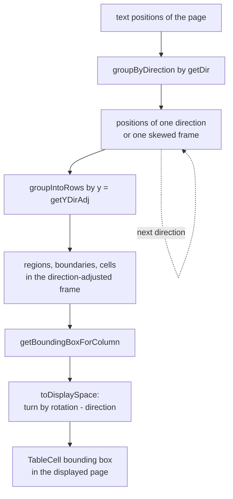
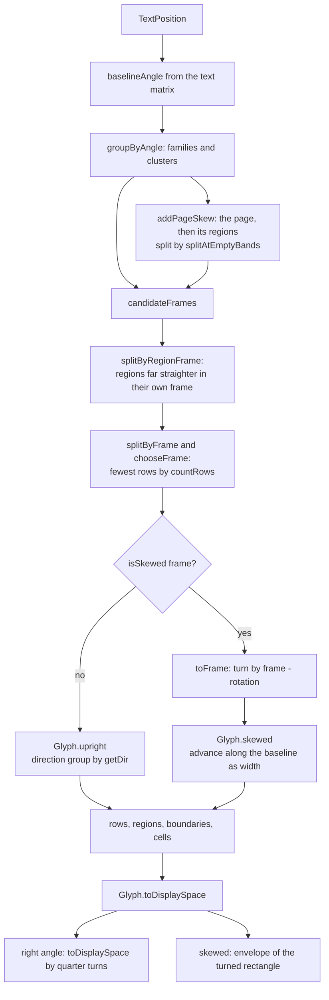
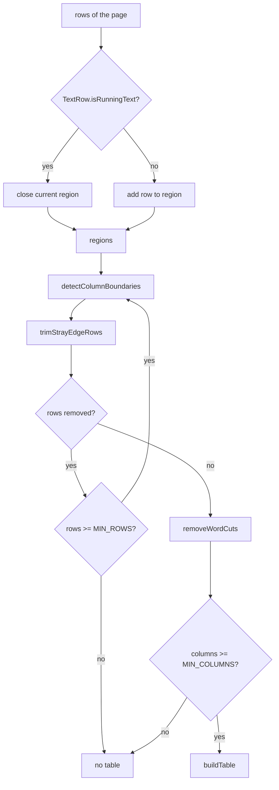
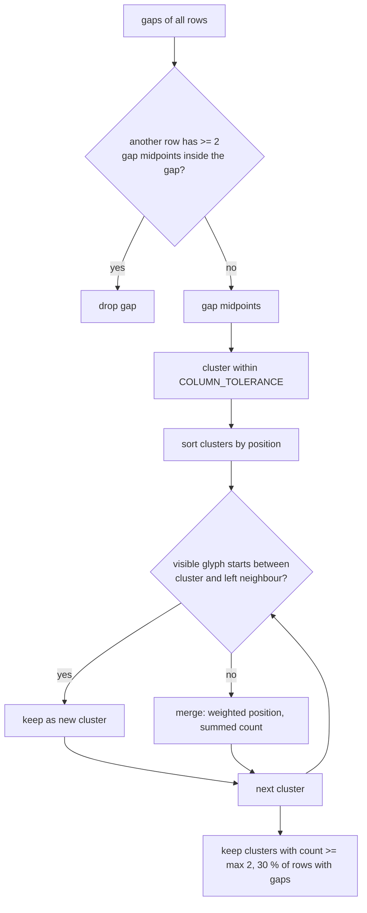
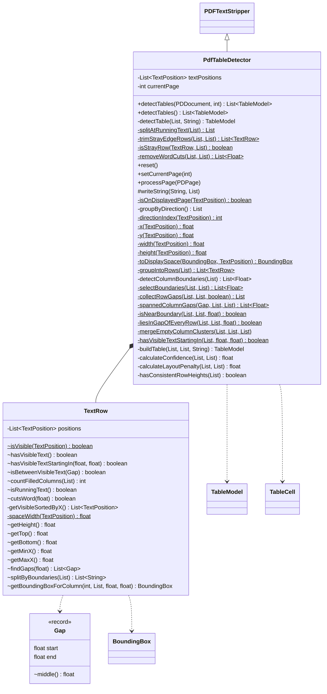
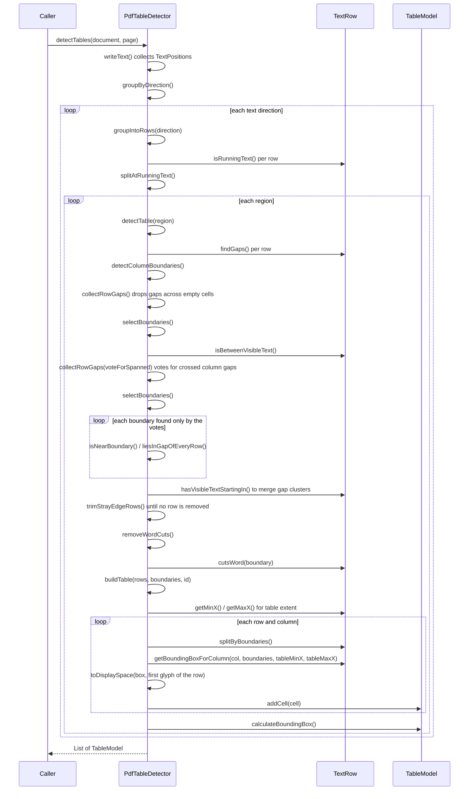

# PdfTableDetector

Detects borderless tables on a PDF page from text positions. It extends PDFBox
`PDFTextStripper`, collects every `TextPosition` of the page and builds a `TableModel` for each
table found by the layout heuristics:

1. Text positions are grouped by text direction, each direction is searched separately in its
   direction-adjusted frame; skewed text gets one group per frame angle (see below)
2. Text positions are grouped into rows by their Y coordinate (tolerance 3 pt)
3. Rows of running text split the page into regions, each region is searched for one table (see
   below)
4. Gaps wider than `GAP_THRESHOLD` × average glyph width are column gap candidates, a gap that
   runs across an empty cell is dropped (see below)
5. Gap midpoints are clustered (`COLUMN_TOLERANCE`), neighbouring clusters with no visible glyph
   starting between them are merged (see below); a cluster found in at least 30 % of the rows with
   gaps (and at least twice) becomes a column boundary
6. Stray rows at the region edges are trimmed and boundaries inside a word are removed (see
   below)
7. Each row is split by the boundaries into cells; the first row is the header
8. Confidence is scored from the row/column count and row height consistency, minus a layout
   table penalty (many rows, many empty cells, long sentences)

Used by the standalone `table-detector` plugin and by `vim-parser-table` (portunix-vim repository), which bundles this JAR.

## Text direction and rotated pages

`TextPosition.getX` / `getY` / `getWidth` / `getHeight` are reported in the displayed page, after
the page `/Rotate`. On a rotated page the text of a table runs vertically there, grouping by `getY`
made every glyph column a row and the word gaps column boundaries (issue #173). All geometry
therefore goes through the helpers `x`, `y`, `width` and `height`, which return the
direction-adjusted values (`getXDirAdj`, `getYDirAdj`, `getWidthDirAdj`, `getHeightDir`). In that
frame the text runs from left to right and y grows downward, whatever the page rotation and the
text matrix are. For upright text on an unrotated page both sets of values are the same.

- `groupByDirection` splits the text positions by `TextPosition.getDir` (`directionIndex`, quarter
  turns 0 to 3) and `detectTables` runs the row grouping and the region search for each direction,
  0° first. A label rotated by 90° in the margin of a horizontal table then does not add glyphs to
  its rows, and table ids continue across directions
- `toDisplaySpace` turns each cell box back into the displayed page, the coordinate system of
  `BoundingBox`. The frame of direction `d` is the media box (`getPageWidth` × `getPageHeight`,
  swapped for 90° and 270°) and it turns clockwise by `(getRotation − d) mod 360` into the
  displayed page:

| Turns | Displayed box of `(x, y, w, h)` in a frame `W` × `H` |
| ----- | ---------------------------------------------------- |
| 0 | `(x, y, w, h)` |
| 1 (90°) | `(H − y − h, x, h, w)` |
| 2 (180°) | `(W − x − w, H − y − h, w, h)` |
| 3 (270°) | `(y, W − x − w, h, w)` |

The table bounding box is the union of the displayed cell boxes, so it is in the displayed page
too.

PDFBox also reports text outside the crop box, with coordinates beyond the displayed page. Viewers
do not show it, so a hidden column would add a column to the table. `writeString` keeps a glyph
when at least a part of its box lies on the displayed page (`isOnDisplayedPage`). The glyph box is
built in the direction frame and turned by `toDisplaySpace`, because `getWidth` and `getHeight` do
not follow the text direction.

- A cell crossing the page edge holds only its glyphs that are at least partly visible, the text
  is cut as in a viewer (`Truncated0` becomes `Trun`).
- A kept glyph can start left of the page, so its x can be negative and the first column sentinel
  is `-Float.MAX_VALUE`, not `0`. The cell box then reaches beyond the page edge by that overlap.
- PDFBox clips the crop box to the media box, which gives an empty box for a zero sized crop box or
  one disjoint from the media box, while viewers still show the page. `processPage` then uses the
  media box for the time of processing and restores the declared crop box afterwards.

## Skewed text

`TextPosition.getDir` returns only 0, 90, 180 or 270. Text at 30° fell into direction 0, its
baseline rose along the row, so the cells of one row ended up in different rows and columns, and
`getWidthDirAdj` shrank by `cos 30°` (issue #208). Typical sources are OCR text layers of skewed
scans and drawings with rotated title blocks.

- `baselineAngle` reads the real angle from the text rendering matrix,
  `atan2(shearY, scaleX)`. The matrix does not contain the page `/Rotate`. Shear along the baseline
  (italics) does not change it
- `groupByAngle` sorts text positions by angle and starts a new group where two neighbours differ
  by the given gap or more. Angles are circular, so the groups at both ends of the range join when
  the step over 0° is smaller. `ANGLE_GAP` (1°) gives the **families**, `ANGLE_STEP` (0.15°) the
  **clusters** inside a family
- The glyph angle only proposes a frame, the **position of the text decides**. An OCR layer can write
  exact angles on a skewed page, noisy angles on an upright grid, and even a block at exactly 0° on
  a page skewed by 1.5°. `candidateFrames` offers right angles, family means and the means of clusters
  with `FRAME_MIN_SHARE` (10 %) of the page, each frame with the number of glyphs supporting it
- `straightestFrame` corrects the frame of a family or cluster with that share: it searches
  `FRAME_SEARCH_RANGE` (±1.5°) in `FRAME_SEARCH_STEP` (0.1°) for the fewest rows of that group, a tie
  keeps the closest angle, and the nearest right angle wins when it gives no more rows
- `addPageSkew` finds the skew of the page from positions alone, some OCR layers write angles with no
  trace of it (issue #211). For the glyphs within `PAGE_SKEW_RANGE` (±5°) of a right angle it searches
  in `FRAME_SEARCH_STEP` for the fewest rows, on at most `PAGE_SKEW_MAX_GLYPHS` (2000) evenly spaced
  glyphs. Short rows stay straight over a range of angles, so it takes the middle of that range. The
  angle is offered only when it leaves at most `PAGE_SKEW_MAX_ROWS` (75 %) of the rows of the right
  angle, a page with an upright and a 2° table gains nothing from either frame. The whole page only
  proposes: each family still takes the frame by its own rows, so a table that is straight at its own
  angle keeps it. The offered frame wins every tie and replaces skewed frames closer than
  `PAGE_SKEW_SAME_FRAME` (0.25°), so a family too small to show the skew joins the rest of the page
- **Regions** handle tables at different skew whose OCR layer writes one angle, the whole page gains
  nothing from either frame there (issue #213). `splitAtEmptyBands` splits text at bands wider than
  `REGION_MIN_GAP` (40 pt) across the rows of the right angle, before any frame is known. With at least
  two regions of `REGION_MIN_ROWS` (4) rows, `addPageSkew` searches each of them and offers its skew.
  `isFarStraighter` decides: at least `REGION_MIN_ROWS` rows in that frame and at most
  `REGION_MAX_ROWS` (40 %) of the rows of the best frame so far. The bound is stricter than for the
  page, two columns on offset baselines line up at some angle and halve their rows, a skewed table of
  three or more columns falls to a third. With `REGION_MIN_COLUMNS` (3) columns in the frame, counted as
  empty bands across it, `REGION_MAX_ROWS_COLUMNS` (50 %) is enough: columns of a true table can land on
  neighbouring rows and only pair up (issue #215). The bar leaves out the page skew, a compromise
  between two tables, the frames that gave way to it and frames more than 45° from the right angle, which count the width of the text
  rather than rows. A table split by a band gains nothing and stays in one frame
- `splitByRegionFrame` takes the regions passing `isFarStraighter` out of a family, each is a part of
  its own for `splitByFrame`, the rest stays together. A family without such a region takes the path
  it took before, so a page that gains nothing keeps its result
- `countRows` counts the rows of the glyph origins in a frame: origins further apart than `ROW_GAP`
  (0.75 pt) start a new row, and a row higher than `ROW_TOLERANCE` counts once per 3 pt of its height,
  because lines crossing the rows of the frame run together into one tall row
- `chooseFrame` takes the frame with the fewest rows within 45°. On a tie the frame with the most
  glyphs wins, then the closest one. Text of one row in its own frame has no rows to tell, every frame
  ties for it, so a turned cell stays in the frame of its table. A row of `LINE_MIN_GLYPHS` (25) glyphs
  or more is a line of its own, a watermark for example, and takes the frame with the fewest rows like
  any other text. A family supports its mean only
  when its rows are straighter there than at the nearest right angle, so scattered cells of an upright
  table do not support a frame
- `splitByFrame` handles a family that mixes text of several frames, an upright table next to a
  noisy paragraph at 1.2° for example, whose angles run into each other. The glyphs go to the nearest
  of the right angle and the means of clusters with 10 % of the family. That split is kept only when
  it gives fewer rows than the single frame of the whole family
- `isSkewed` treats a frame within `RIGHT_ANGLE_EPSILON` (0.05°) of a right angle as that right angle.
  Such glyphs go to the direction groups by `directionIndex` and take the path described above
  unchanged, so a page with right angles only keeps the exact #173 result
- Skewed frames follow the four directions, in ascending angle, so they get the later table ids
- `toFrame` turns the group by its frame angle in the displayed page, `frame − getRotation`, and
  `Glyph.skewed` stores the glyph in that frame. The origin
  comes from `getX` / `getY`, the width is the length of the advance along the baseline (`getEndX`
  / `getEndY` against the matrix translation), the height is `getHeightDir`
- `continuesWord` tells that a glyph starts where the previous one ends on a baseline of the same
  angle. `toFrame` keeps such a glyph on the row of the word start, because an OCR layer can write a
  word at 0° in a frame of 3° and the end of a long word would leave `ROW_TOLERANCE` (issue #211)
- Frame coordinates can be negative, nothing depends on their sign: the column sentinels are
  `±Float.MAX_VALUE` and the frame origin stays the page origin

`Glyph` carries the frame coordinates for every group, `TextRow` and the column detection read
only `x`, `y`, `width` and `height` of a glyph and do not know which frame they are in. `angle` 0
marks the direction-adjusted frame.

`Glyph.toDisplaySpace` turns a cell box back into the displayed page. `BoundingBox` is axis-aligned,
so a skewed cell becomes the **axis-aligned envelope** of its turned rectangle, with the sides
`w·|cos a| + h·|sin a|` and `w·|sin a| + h·|cos a|`. Envelopes of neighbouring skewed cells may
overlap and may contain glyphs of a neighbouring cell. Consumers that need exact cells have no
angle in the API, it was left out on purpose because it would change the JSON output for a rare
case. The table box is the union of the envelopes.

Known limits: a slightly skewed paragraph whose word angles overlap those of an upright table, 0.8°
with ±0.6° for example, can stay in one frame with the table. A 0° and a 0.5° table on one page share
a frame. A long word turned in an upright table keeps its row only as far as its baseline stays within
`ROW_TOLERANCE`, the rest of the word falls into a neighbouring row, as before #208, only skewed frames
keep words together. Tables at different skew are told apart only across a band that stays empty at a
right angle, `REGION_MIN_GAP` plus the drift of the text, about 26 pt for 500 pt of text at 3°, so tables
side by side or close together share a frame. An OCR layer can write each row at its own slope,
Tesseract does so with `--psm 4` and `6` when one block holds both tables, then no frame fits and the
rows split. It can also write a −2° table at −0.4°, which shares a frame with an upright table. A skewed
table of two columns does not reach `REGION_MAX_ROWS`. Two tables whose skews differ by 0.5° can share a
frame, and dense tables at opposite skews about 5° apart can merge. Upright text whose rows follow one
slope within ±5°, staircase labels or a table with offset columns, looks like an OCR layer at 0° and
takes that frame, even where it forms no real table, a block of it with three or more columns does so
on its own between bands. A curved page has no single frame. A big watermark line at 10° to 20° and short chart labels beside a table still break it.

`isOnDisplayedPage` keeps its box from the direction frame, which is only an approximation for
skewed glyphs. Skewed text beyond the page edge is dropped like any other text, its cells stay
empty.

## Regions and running text

On a report page most rows are running text. Their word gaps meet by chance at the same x in a few
rows, those positions became column boundaries and the whole page body one table with words split
into cells (issue #200). Running text now never takes part in a table:

- `TextRow.isRunningText` marks a row with at least `RUNNING_TEXT_MIN_GLYPHS` (40) visible glyphs,
  at least `RUNNING_TEXT_MIN_WORDS` (6) words and even word gaps: the median word gap is at most
  `RUNNING_TEXT_MAX_WORD_GAP` (6) space widths and the widest at most
  `RUNNING_TEXT_MAX_GAP_RATIO` (2) × the median. Justified text has wide but even gaps, a table row
  has few words or column gaps much wider than the word gaps inside its cells. A word gap is a gap
  of at least `WORD_GAP_RATIO` (0.5) space widths (`TextPosition.getWidthOfSpace`)
- `splitAtRunningText` drops these rows and splits the page at them into regions,
  `detectTable` searches each region for one table, so a matrix between paragraphs gets its own
  bounding box and a page has `table-1`, `table-2`, ... in order from the top
- `trimStrayEdgeRows` removes rows at the top and bottom of a region that have visible text in one
  column only or text across a boundary without a column gap (`liesInGapOfEveryRow` of that row),
  e.g. the short last line of a paragraph or a heading next to the table. The boundaries are
  computed again after every trim until no row is removed. A row without visible text is never
  stray
- `removeWordCuts` drops a boundary that falls between two neighbouring visible glyphs of one word
  in any row of the table (`TextRow.cutsWord`), the columns it separated are merged. A table left
  with fewer than `MIN_COLUMNS` columns is not reported

Known limitations: a table of six or more single-word columns spaced at most six space widths
apart with at least 40 glyphs per row looks like running text, and a bulleted list still forms a
two-column table.

## Column boundaries

`TextRow.findGaps` returns each gap as a `Gap` (`start` = right edge of the left glyph, `end` =
left edge of the right glyph) and its `middle()` is the boundary candidate.

### Gaps across an empty cell

When a middle cell of a row is empty, the row has one wide gap from the left to the right
neighbouring column and its midpoint lies inside the empty column. Rows like that would vote for a
boundary that splits the wider values of the column, e.g. `1,234.50` into `1,2 | 34.50`
(issue #180). `collectRowGaps` drops a gap when another single row has at least two gap
midpoints strictly inside it, the gap then crosses more than one column gap. A row whose gaps are
all dropped does not count as a row with gaps, so it does not raise the occurrence threshold.

Dropping these gaps loses column gaps that only few rows show. When only one row fills all
columns (usually the header), every other row loses its gaps and no boundary reaches the occurrence
threshold; when every data row skips a different column, the gap between two of them is seen only
in the header (issue #182). `detectColumnBoundaries` therefore selects boundaries twice
(`selectBoundaries`): once with the dropped gaps and once with `voteForSpanned`, where a dropped gap
votes for the gap midpoints of the row with the most midpoints inside it (`spannedColumnGaps`)
instead of its own midpoint. Only a gap between visible glyphs votes
(`TextRow.isBetweenVisibleText`), a gap after a whitespace glyph at the row edge stays dropped.

A boundary found only by the votes is added when it does not cut through text: in every row it lies
outside the visible text or inside a gap (`liesInGapOfEveryRow`), and a visible glyph starts between
it and each kept boundary (`isNearBoundary`). Flowing text on real pages fails the first check, so
those pages keep the #180 result. A single line of text across a column gap rejects that boundary
for the whole table.

### Clustering

The midpoint moves with the right edge of the text in the left column: `3` and `1,234.50` in the
same column give midpoints about 18 pt apart. With the fixed `COLUMN_TOLERANCE` of 5 pt one column gap then falls into several clusters
and each of them either becomes its own boundary (a phantom column empty in every row) or misses
the occurrence threshold (a lost column), issue #178.

`mergeEmptyColumnClusters` sorts the clusters by position and merges each one into its left
neighbour when no visible glyph of any row starts between them (`TextRow.hasVisibleTextStartingIn`,
the same `[start, end)` rule as `splitByBoundaries`). The merged position is the average weighted
by the counts and the counts are summed. It runs before the occurrence filter, so the merged
cluster counts all rows of the gap. Splitting is unchanged by the merge, no glyph starts in the
merged range.

## Cell bounding boxes

`TextRow.splitByBoundaries` and `TextRow.getBoundingBoxForColumn` wrap the detected boundaries
with the sentinels `0` and `Float.MAX_VALUE`, so text left of the first and right of the last
boundary still falls into a column. The sentinels are not real coordinates (issue #164):

- Only visible glyphs count for geometry (`TextRow.isVisible`); whitespace glyphs, e.g. invisible
  spaces at the page edge, still go into the cell text but never into a bounding box. No-break
  spaces (`U+00A0`, `U+2007`, `U+202F`) count as whitespace too, `Character.isWhitespace` alone
  would miss them
- A cell with visible text gets the extent of its visible glyphs
- An empty cell gets the column range limited by the table text extent (`tableMinX`,
  `tableMaxX`, computed in `buildTable` from the visible glyphs of all rows), so an empty first or
  last cell never reaches `x = 0` or `Float.MAX_VALUE`
- A row without visible text has no bounding boxes (`null`)

Vertically, `y` (`TextPosition.getYDirAdj`) is the glyph baseline measured from the top of the
frame and the glyph lies above it (issue #172). Every glyph has its own baseline and height, so mixed font sizes
and shifted baselines (e.g. superscripts within the 3 pt row tolerance) keep their own extent:

- A cell with visible text spans `min(y − height)` .. `max(y)` of its visible glyphs
- An empty cell spans the vertical extent of the visible glyphs of the whole row
  (`TextRow.getTop` .. `TextRow.getBottom`)

The glyph height from `TextPosition.getHeightDir` is smaller than the font size, so ascenders and
descenders may be clipped slightly.

So the table bounding box (`TableModel.calculateBoundingBox`) equals the union of the cells with
text. `buildTable` passes every box through `toDisplaySpace` before it sets it on the cell.

## Structure

## Flow

