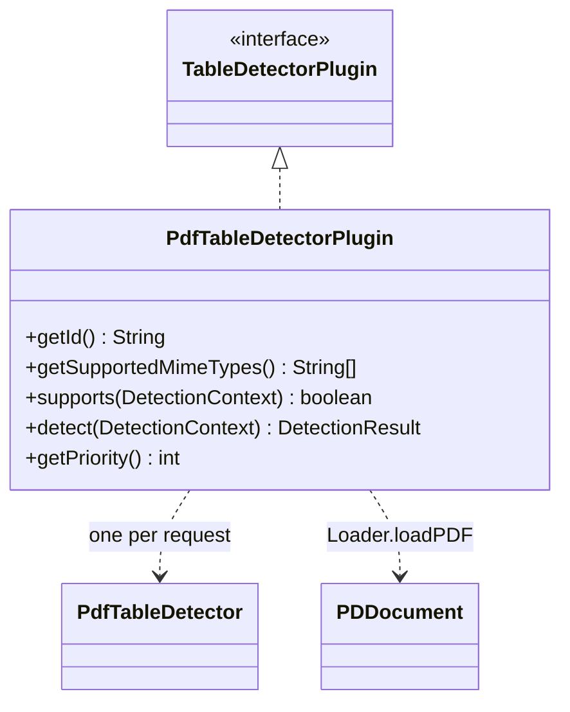
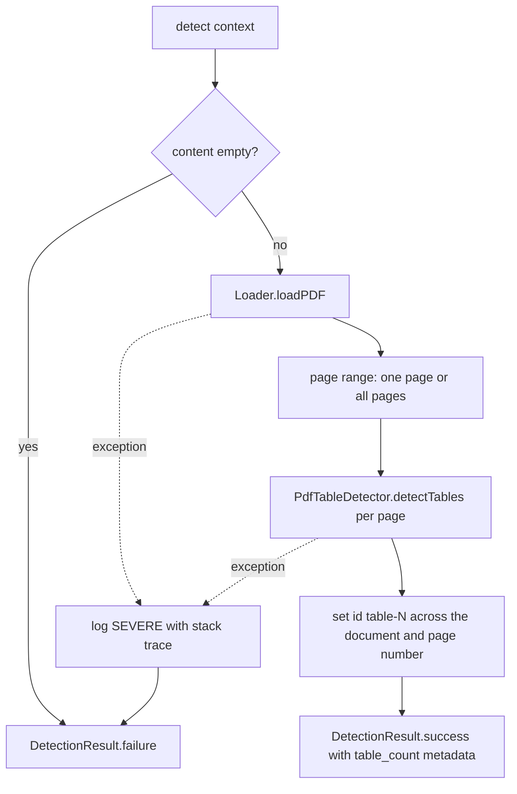

# PdfTableDetectorPlugin

PF4J extension (`@Extension`) implementing `TableDetectorPlugin` for PDF input. It loads the
document with PDFBox, runs `PdfTableDetector` on the requested page (or on all pages) and
numbers the tables across the whole document.

- **Id**: `pdf`
- **MIME types**: `application/pdf`, with the `.pdf` file name extension as a fallback
- **Priority**: 10

## Structure

## Detection flow

Table ids from `PdfTableDetector` are per page; the plugin overwrites them with a counter that
runs through the whole document.

## Logging

The logger comes from `LogFactory.getLogger` (`java.util.logging`). A failed detection is logged
at `SEVERE` with the exception, so the stack trace is kept, and returned as
`DetectionResult.failure` with the exception message.
