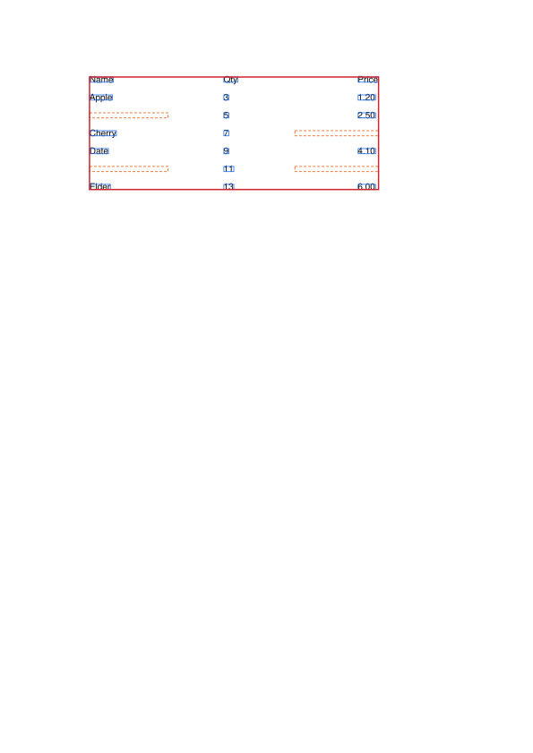
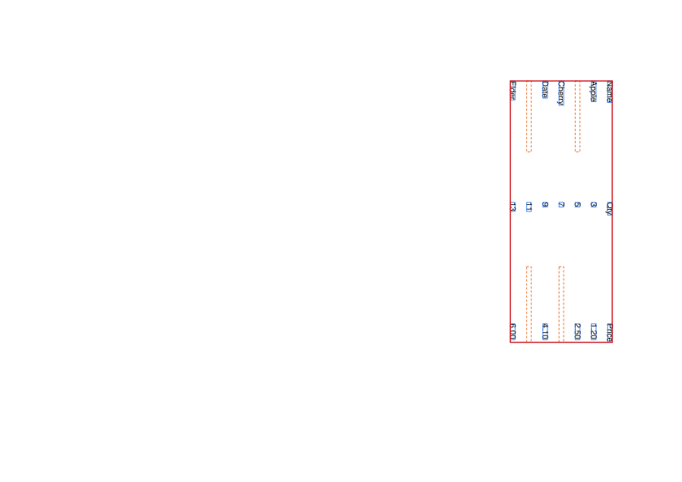
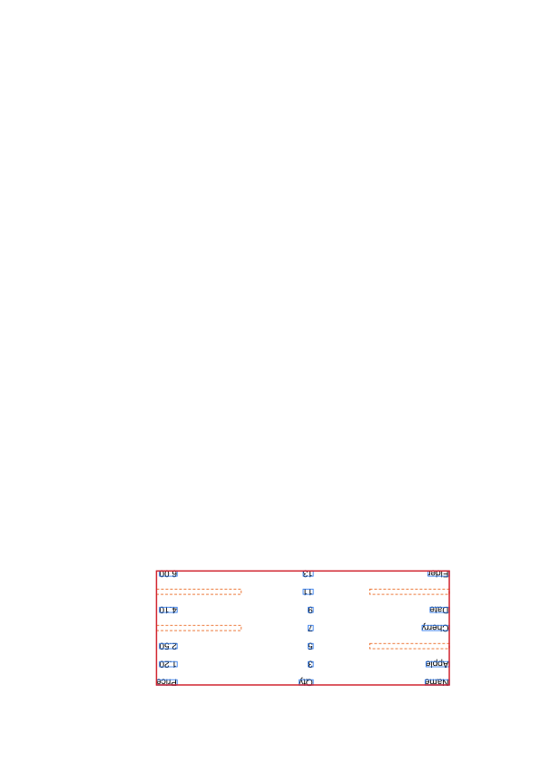
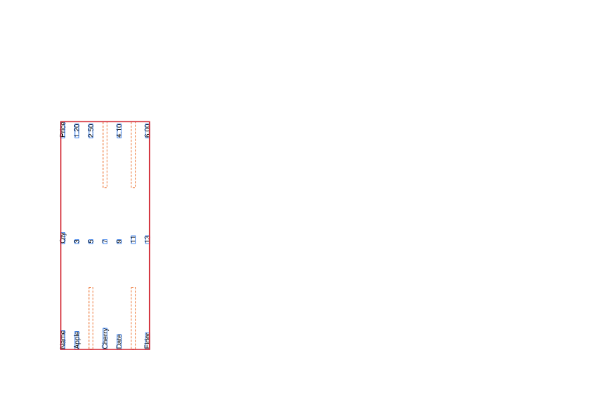
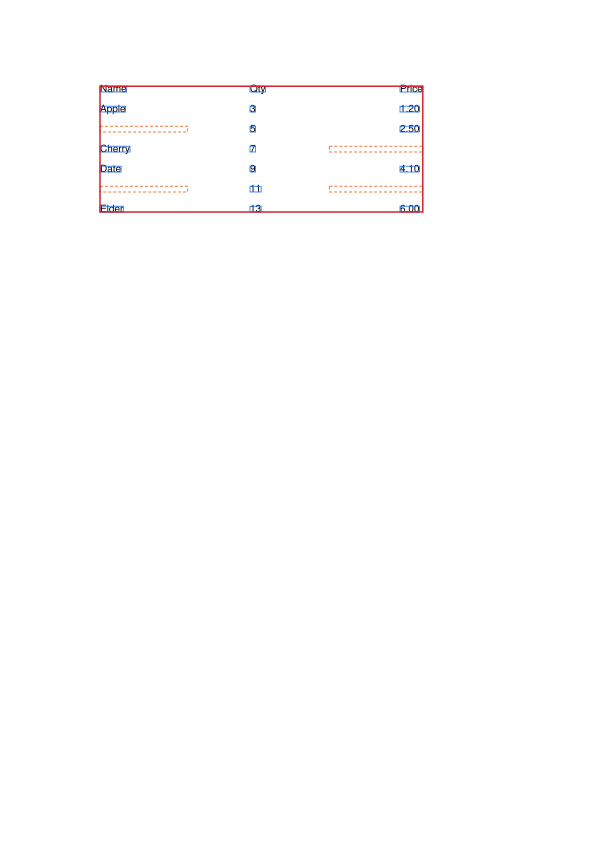
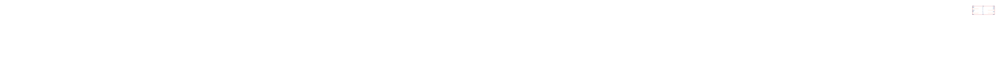
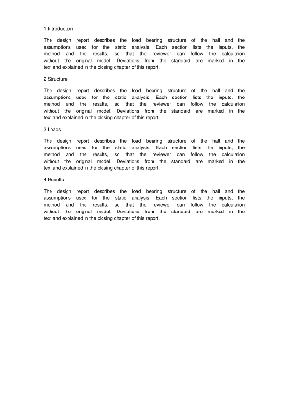
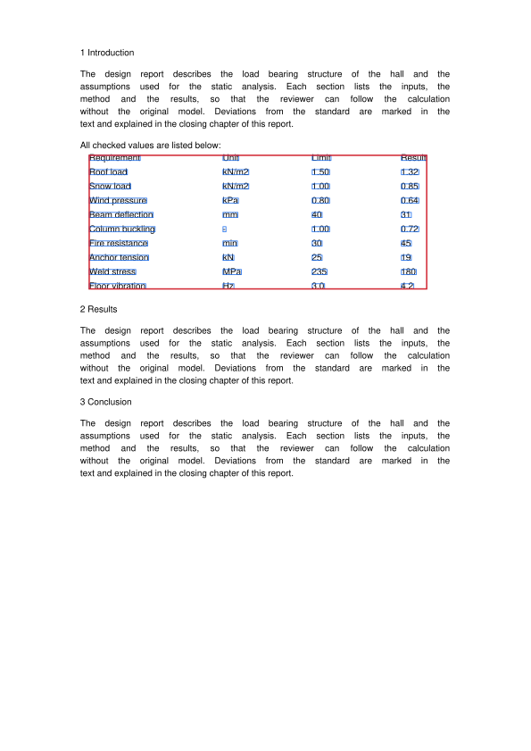

# PdfTableDetectorTest

Tests `PdfTableDetector` on synthetic PDFs built in memory, no sample files are needed. The focus
is on cell bounding boxes of empty edge cells and whitespace glyphs (issue #164) and on column
boundaries for values of different widths (issues #178, #180, #182), on running text pages
(issue #200) and on rotated pages and text (issue #173), see
[PdfTableDetector.md](../../../../../../../main/java/org/cassandragargoyle/portunix/tabledetector/pdf/PdfTableDetector.md).

## Synthetic PDF

`createSyntheticPdf(PDRectangle mediaBox, int rotation, float xOffset, float yTop)` creates a
one-page document with the table `ROWS` drawn in Helvetica 10 pt:

- `mediaBox`: page size and origin, e.g. `PDRectangle.A4` or a shifted rectangle
- `rotation`: value for `PDPage.setRotation` (`/Rotate`), the content itself is not rotated
- `xOffset`: added to every X coordinate, used to move the table to a shifted media box or to the
  far right edge of a large page
- `yTop`: baseline of the first row from the bottom of the page (`Y_TOP` = 750 pt in
  `@BeforeAll`), every further row is `ROW_STEP` (20 pt) lower

Column layout:

| Column | Left edge (`COLUMN_X`) | Content |
| ------ | ---------------------- | ------- |
| 0 | 100 pt | Name |
| 1 | 250 pt | Qty |
| 2 | 400 pt | Price |

Rows of `ROWS` (`""` is an empty cell, `" "` a whitespace glyph):

| Row | Name | Qty | Price | Purpose |
| ----- | ----- | ----- | ----- | ------- |
| 0 | `Name` | `Qty` | `Price` | header |
| 1 | `Apple` | `3` | `1.20` | full row |
| 2 | `" "` | `5` | `2.50` | whitespace glyph in the first cell |
| 3 | `Cherry` | `7` | `""` | empty last cell |
| 4 | `Date` | `9` | `4.10` | full row |
| 5 | `""` | `11` | `""` | empty first and last cell |
| 6 | `Elder` | `13` | `6.00` | plus `U+00A0` at the page edge (`NBSP_ROW`) |
| 7 | `" "` | `""` | `""` | whitespace glyphs only |

Whitespace glyphs are drawn at `WHITESPACE_X` (2 pt from the left edge), not in their column,
like invisible spaces in real invoices. They are not visible in the pictures below, but without
the fix they spread the table bounding box to the page edge.

`mixedFontSizesGiveEachCellItsOwnHeight` and `shiftedBaselineKeepsCellsOnTheirOwnBaseline` use
`detectMixedRow(Text...)`: rows 0, 2 and 3 are 10 pt text from `ROWS`, row 1 is the given `Text`
(value, font size, baseline shift) per column. They are not part of the pictures below.

The column gap tests (issues #178, #180, #182) use `detectRows(String[][])`: 10 pt text at `COLUMN_X`
(or the columns given to `detectRows(float[], String[][])`, a negative x is the right edge of a
right-aligned column), a `^`
in a value draws the rest in 6 pt, 12 pt right of the start (`10^kg` is `10` and a small `kg`),
`""` is an empty cell.
`assertNoColumnEmptyInAllRows` fails on a phantom column. These tables are not part of the
pictures below either.

Running text pages (issue #200) are built by `createProsePdf()` and `createProseWithMatrixPdf()`
from `Line`s: a single string is a line of text at `PROSE_X` (90 pt), more strings are a matrix row
at `MATRIX_X` (100, 250, 350, 450 pt). `PROSE` is wrapped to `PROSE_WRAP_WIDTH` (330 pt) and every
line but the last of a paragraph is justified to `PROSE_WIDTH` (415 pt). `drawWords` draws the
words one by one without space glyphs, like justified text in a CID font, so the word gaps exceed
the column gap threshold, which made the detector report the whole page as one table.

## Variants

The SVGs are rendered from the generated PDFs with `pdftocairo -svg` (white background added) and
overlaid with the bounding boxes `PdfTableDetector` returns for them:

| Line | Meaning |
| ----- | ------- |
| solid blue | cell with text |
| dashed orange | empty cell (blank text) |
| thick red | table bounding box |

Cells without a bounding box (row 7, whitespace glyphs only) have no rectangle.

`BoundingBox.y` is the top edge of the glyphs measured from the top of the page and the box ends
at the baseline (issue #172), so the rectangles sit around the glyphs.

### A4, no rotation

`createSyntheticPdf(PDRectangle.A4, 0, 0f, 750f)`, shared by most tests through `@BeforeAll`.



### Rotated pages

`createSyntheticPdf(PDRectangle.A4, rotation, 0f, 750f)` with `rotation` 90, 180 and 270, tests
`rotatedPageGivesSameGridAsUnrotatedPage`, `rotatedPageBoxesCoverDisplayedText` and
`rotatedPageKeepsBoundingBoxesFinite`. Viewers display the page rotated and the text runs
vertically or upside down. The detector reads the text in its own reading direction, so the grid
is the same 8 × 3 as on the unrotated page, and turns the boxes back into the displayed page
(issue #173).







`verticalLabelDoesNotSplitHorizontalTable` adds a label drawn with a text matrix rotated by 90°
in the left margin of the A4 variant, across the table rows. It is not part of the pictures.

`cropBoxSmallerThanMediaBoxOnRotatedPage` shifts the A4 variant by 50 pt and sets the crop box
`(40, 50, 500, 740)`. PDFBox reports positions relative to the crop box, the displayed page is the
turned crop box. `textOutsideCropBoxIsIgnored` draws a whole column left of the crop box: PDFBox
still reports it and the detector ignores it, so the table has the two visible columns only.
`partlyVisibleGlyphsAreKept` and `cellCrossingCropBoxEdgeHoldsVisibleText` cover glyphs on the crop
box edge: a glyph stays while a part of it is visible. `emptyCropBoxFallsBackToMediaBox` covers a
crop box with a zero side and one disjoint from the media box, PDFBox clips both to an empty box. These
tests and `textOutsideCropBoxIsIgnored` draw their pages with `createColumnsPdf`.

`createRotatedRowsPdf(int rotation, float[]... placements)` draws `ROWS` once per placement (origin
x, origin y of the first baseline, text angle in degrees) with `drawRotatedRows`, which turns the
text matrix and the cell origins around the table origin. Whitespace cells are drawn in their
column and the no-break space of `NBSP_ROW` is left out, so the reference grid is
`createCenteredRowsPdf(int rotation, int theta)` places them so that the table centre stays in the
page centre at any angle and no cell leaves the page.

`detectUprightRows()`, the same rows upright on an unrotated page. Used by
`textTurnedAgainstPageRotationIsUpright` (text turned by 270° on `/Rotate 90`, displayed upright)
and `tablesInTwoDirectionsAreDetectedSeparately` (a horizontal table and one turned by 90° on one
page). They are not part of the pictures.

`assertBoxesCoverDisplayedText` collects the glyph origins PDFBox reports in the displayed page
(`getX`, `getY`), checks that every text cell box covers its first visible glyph, every visible
glyph lies in a table box and every table box lies inside the displayed crop box.

### Offset media box

`createSyntheticPdf(new PDRectangle(100, 100, 595, 842), 0, 100f, 850f)`, test
`offsetMediaBoxLimitsTableToText`. The media box starts at `(100, 100)` and the content is shifted
by the same amount, so it looks like the A4 variant. PDFBox reports text positions relative to the
media box, so the table must still start at `COLUMN_X[0]`.



### Page at max coordinate

`createSyntheticPdf(new PDRectangle(14400, 842), 0, 13900f, 750f)`, test
`pageAtMaxCoordinateKeepsTableBoundingBox`. The page is 14400 pt wide (the PDF maximum) and the
table sits near its right edge, so the bounding boxes must survive the `TableModel` guard.



### Running text only

`createProsePdf()`, test `runningTextPageHasNoTable`. Four headings, each followed by a justified
paragraph. No table is detected, so the picture has no overlay.



### Matrix between paragraphs

`createProseWithMatrixPdf()`, test `matrixBetweenParagraphsIsItsOwnTable`. A paragraph, the short
line `MATRIX_INTRO` right above the 10 × 4 `MATRIX` and two more paragraphs. The table box covers
the matrix only, the intro line is trimmed as a stray edge row.



## Tests

| Test | Checks |
| ----- | ------ |
| `detectsGridWithEmptyEdgeCells` | 8 rows × 3 columns, empty cells have empty text |
| `allBoundingBoxesInsidePage` | no sentinel `0` / `Float.MAX_VALUE`, every box inside the page |
| `emptyEdgeCellsLimitedByTableExtent` | empty first/last cell end at the table edge, not in a neighbour column |
| `whitespaceGlyphsIgnoredForGeometry` | whitespace and `U+00A0` glyphs do not widen the table or a cell |
| `tableBoxEqualsUnionOfTextCells` | table box is the union of the cells with text |
| `textCellsKeepTextExtent` | text cells keep the extent of their glyphs |
| `textCellBoxesCoverGlyphsAboveBaseline` | text cell box starts above the baseline and ends at it |
| `mixedFontSizesGiveEachCellItsOwnHeight` | 6/20/10 pt in one row, each cell gets the height of its own glyphs |
| `shiftedBaselineKeepsCellsOnTheirOwnBaseline` | cell 2 pt above the row baseline ends at its own baseline |
| `emptyCellSpansVerticalExtentOfRow` | empty cell takes the vertical extent of the row text |
| `varyingCellWidthsGiveOneBoundaryPerColumnGap` | `Qty`, `10kg`, `3`, `3` in the middle column give 3 columns, none empty in all rows |
| `alternatingNarrowAndWideValuesGiveOneBoundary` | `3` and `1,234.50` alternating give 3 columns |
| `sparseRealColumnIsNotMerged` | middle column with `X` in 2 of 6 rows stays a column, the wide gaps of the other rows do not add one |
| `emptyMiddleCellsDoNotAddColumn` | empty middle cells in some rows give 3 columns, not a phantom column |
| `wideGapAcrossEmptyMiddleCellDoesNotSplitColumn` | the wide gap of rows with an empty middle cell does not split `1,234.50`, 3 columns |
| `boundaryInsideWordIsRemoved` | a long word across the `Name` / `Qty` gap removes that boundary, 2 columns |
| `runningTextPageHasNoTable` | justified paragraphs give no table |
| `matrixBetweenParagraphsIsItsOwnTable` | one 10 × 4 table with the matrix text, its box covers the matrix only |
| `rotatedPageKeepsBoundingBoxesFinite` | rotated page, finite boxes |
| `rotatedPageGivesSameGridAsUnrotatedPage` | `/Rotate` 90, 180, 270 give the 8 × 3 grid and cell texts of the unrotated page |
| `rotatedPageBoxesCoverDisplayedText` | on rotated pages every text cell box covers its first glyph and the table box all visible glyphs, as PDFBox reports them in the displayed page |
| `verticalLabelDoesNotSplitHorizontalTable` | a 90° label across the table rows leaves the 8 × 3 grid unchanged |
| `cropBoxSmallerThanMediaBoxOnRotatedPage` | crop box smaller than the media box with `/Rotate` 0, 90, 270, same grid, boxes inside the displayed crop box |
| `textOutsideCropBoxIsIgnored` | a column left of the crop box with `/Rotate` 0, 90, 180, 270 gives a 5 × 2 table of the visible columns |
| `partlyVisibleGlyphsAreKept` | a glyph 1 pt left of the crop box and a row with its baseline 2 pt under it stay in the table, `/Rotate` 0, 90, 180, 270 |
| `cellCrossingCropBoxEdgeHoldsVisibleText` | a cell crossing the right crop box edge holds the visible part of its text, `Truncated0` becomes `Trun` |
| `emptyCropBoxFallsBackToMediaBox` | crop boxes with a zero side and a disjoint one give the media box grid and the declared crop box is restored |
| `textTurnedAgainstPageRotationIsUpright` | text turned by 270° on `/Rotate 90` gives the upright grid and a table wider than high |
| `tablesInTwoDirectionsAreDetectedSeparately` | a 0° and a 90° table on one page (`/Rotate` 0 and 90) give two tables, `table-1` is the 0° one |
| `skewedTableGivesSameGridAsUprightTable` | text at 30°, 2°, −2°, 178° and 120° with `/Rotate` 0, 90, 180, 270 gives the upright grid and cell texts, boxes cover the displayed text |
| `angleNoiseOfCellsKeepsTableTogether` | every cell text turned by a random angle up to 0.1°, 0.3°, 0.5° and 1° around 0°, 2°, −2°, 30° and 90° with `/Rotate` 0, 90, 180, 270 gives one table with the upright grid (`NOISE_SEEDS` fixed seeds) |
| `partlyExactCellsKeepNearlyUprightTableTogether` | 25 %, 50 % and 75 % of the cells exactly upright, the rest with noise up to 0.3°, 0.5° and 1° give the upright grid |
| `quantizedAnglesKeepNearlyUprightTableTogether` | cell angles in steps of 0.1°, 0.2°, 0.25° and 0.5° around 0° give the upright grid |
| `angleNoiseOfRowsKeepsNearlyUprightTableTogether` | every row turned by its own angle up to 1° gives the upright grid |
| `slightlySkewedParagraphDoesNotTurnUprightTable` | a paragraph at 0.5°, 0.7° and 0.9° next to a table at 0° to 0.21° leaves the table grid unchanged |
| `slightlySkewedTableStaysApartFromUprightTable` | a 0° and a 1.5° table on one page give two tables with the upright grid |
| `smallExactSkewGivesSameGridAsUprightTable` | text with exact angles of 0.8° to 1.05° and 178.95° with `/Rotate` 0, 90, 180, 270 gives the upright grid, boxes cover the text |
| `ocrAnglesOffPageSkewGiveSameGridAsUprightTable` | positions skewed by −3°, 3°, −1.5° and 1° with `/Rotate` 0, 90, 180, 270 give the upright grid, whether most glyphs lie at 0° and the rest at two thirds of the skew, or every glyph lies at 0° |
| `realOcrLayerOffPageSkewGivesItsTable` | the text-only Tesseract layer `ocr/skewed-3-degrees-two-angles.pdf` with glyphs at 0° and −2.98° on rows skewed by −3° gives one 8 × 4 table |
| `realOcrLayerWithOneAngleGivesTwoTables` | the text-only Tesseract layer `ocr/upright-and-2-degrees-one-angle.pdf` with all glyphs at 0° gives two 8 × 4 tables |
| `realOcrLayerWithFamilyFrameNearPageSkewGivesTwoTables` | the text-only Tesseract layer `ocr/two-skews-family-frame-near-page-skew.pdf` (`--psm 6`) with tables at −1.5° and −3° gives two 8 × 4 tables, the frame of the family that gave way to the page skew must not set the bar for a region |
| `tablesAtDifferentSkewWithOneGlyphAngleStayApart` | a 0° table and a ±1.5°, ±2° or ±3° table, all glyphs at 0°, give two tables with every cell correct |
| `smallUprightTableKeepsItsGridAboveLargeSkewedTable` | a 5 × 3 upright table above a 24 × 4 table at ±1.5°, ±2° or ±3°, with the large table written at 0° or at its skew, gives both grids |
| `twoSkewedTablesWithOneGlyphAngleStayApart` | tables at 1.5° and −2° or at 2° and 3° in both orders and at two distances, all glyphs at 0°, give two tables with every cell correct, the frame of the page must not set the bar for a region |
| `skewWithColumnsOnNeighbouringRowsStaysApart` | a 0° and a 4.8° table with a row step of 18 pt and a column step of 110 pt give two tables, each column moves half a row, guards `REGION_MAX_ROWS_COLUMNS` |
| `denseTablesAtDifferentSkewStayApart` | two 48 × 8 tables with rows every 6.5 pt at 0° and 2° and at other pairs of skews give two tables, guards the page skew and frames across the rows staying out of the bar |
| `skewedTableSplitByWideBandStaysOneTable` | a table at 2°, −2° or 3° with a band of 110 pt between its rows stays one table of 12 rows |
| `twoColumnsOnOffsetBaselinesTakeNoFrame` | two blocks of two columns on offset baselines take no frame of their own, guards `REGION_MAX_ROWS` |
| `shortStaircaseBlocksTakeNoFrame` | two blocks of three columns and two rows with staircase baselines take no frame of their own, guards `REGION_MIN_ROWS` |
| `tablesAtDifferentAnglesStayApartOnOnePage` | a 0° table and a ±1.5° or ±2° table on one page give two tables with the upright grid |
| `longTurnedLineDoesNotBreakSkewedTable` | a line of 39 glyphs at 12° over a table at 2° leaves the table grid unchanged |
| `angleNoiseOnUprightGridKeepsGridOfUprightPage` | random cell angles up to 1° with upright positions give the upright grid |
| `pageWithManyGlyphsFindsSkewFromPositions` | 100 rows of 4 cells at 0° on rows skewed by 2°, more glyphs than the search sample, give a table of 100 × 4 |
| `longWordAtItsOwnAngleStaysInItsRow` | words of 19 glyphs at 0° on rows skewed by ±3° stay in their row |
| `turnedCellStaysInItsTable` | one cell turned by 1.2° to 30° in a table at 0° and 3° keeps its text in the table |
| `turnedLongWordStaysInItsTable` | a long word at 4° in an empty cell of an upright table stays in the cell |
| `longTurnedLineDoesNotBreakUprightTable` | a single long line at 2° to 45° across an upright table keeps its own frame and the table its grid |
| `noisySkewedTableKeepsItsGrid` | a table at 30° with ±1.5° noise on its cells gives the same grid as the upright table |
| `turnedTextOnUprightGridKeepsUprightGrid` | all cells or the last column at 5° and random cell angles up to 3° on an upright grid give the upright grid |
| `noisyParagraphDoesNotTurnUprightTable` | a noisy paragraph at 1.2° and 1.5° next to a noisy upright table leaves the table grid unchanged |
| `chainOfParagraphAnglesDoesNotTurnUprightTable` | paragraphs at 0.7° and 1.5°, and at 0.9° and 1.8°, chained to an upright table leave its grid unchanged |
| `uprightTextOnSkewedRowsFollowsParagraphFrame` | a block with text at 0° on rows at 1.5° next to a paragraph at 1.5° gives the upright grid |
| `skewedCellBoxIsEnvelopeOfTurnedCell` | the box of a cell at 30° has the sides of the envelope of the upright box |
| `uprightAndSkewedTablesAreDetectedSeparately` | a 0° and a 2° table on one page give two tables with the upright grid |
| `offsetMediaBoxLimitsTableToText` | shifted media box, table starts at the text |
| `pageAtMaxCoordinateKeepsTableBoundingBox` | 14400 pt page, table box kept |

## Regenerating the pictures

[SyntheticPdfSvg.java](SyntheticPdfSvg.java) in the same package (see
[SyntheticPdfSvg.md](SyntheticPdfSvg.md)) calls the package-private factory methods directly. It
is compiled with the tests but not run by surefire. It needs `pdftocairo` (poppler-utils):

```bash
mvn -q install -DskipTests   # once, from the repository root, for table-detector-api
cd table-detector-pdf
mvn -q test-compile dependency:build-classpath -Dmdep.outputFile=target/cp.txt
mkdir -p target/synthetic-pdf
java -cp "target/test-classes:target/classes:$(cat target/cp.txt)" \
  org.cassandragargoyle.portunix.tabledetector.pdf.SyntheticPdfSvg target/synthetic-pdf
cp target/synthetic-pdf/*.svg src/test/java/org/cassandragargoyle/portunix/tabledetector/pdf/synthetic-pdf/
```

For each variant `SyntheticPdfSvg`:

1. Creates the document with its factory (`createSyntheticPdf` with its arguments,
   `createProsePdf` or `createProseWithMatrixPdf`)
2. Saves the document with `PDDocument.save` and runs `PdfTableDetector.detectTables` on it
3. Converts the PDF with `pdftocairo -svg`, adds the white background and appends one `<rect>` per
   bounding box before `</svg>`

Preview the SVGs in a browser, ImageMagick's internal renderer drops the overlay.
