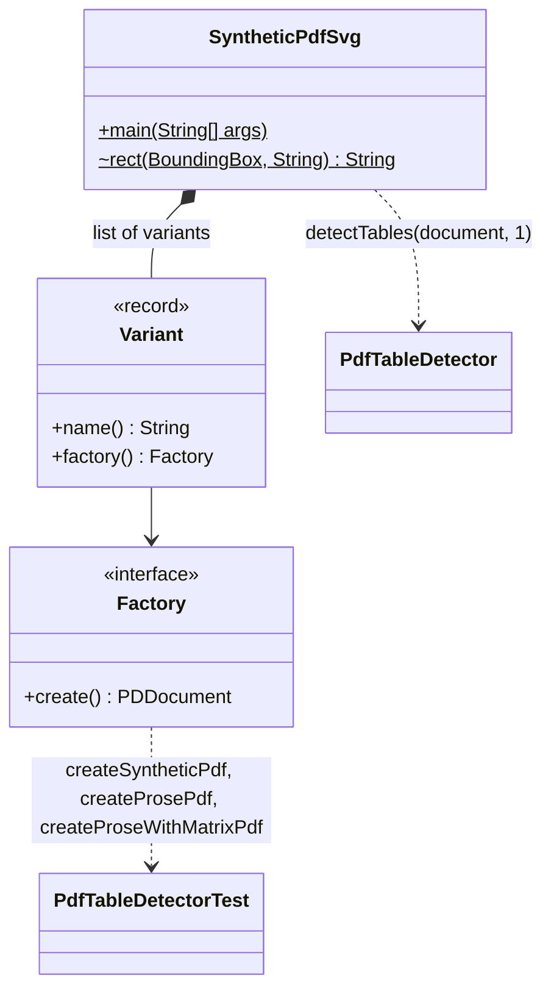
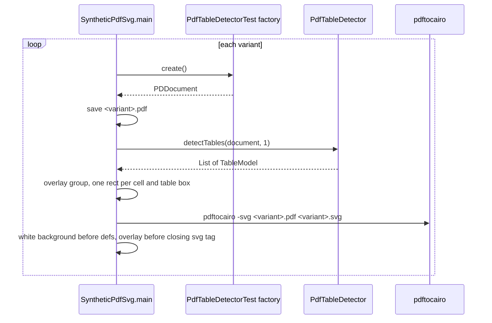

# SyntheticPdfSvg

Developer tool in the test sources, not a test and not part of the production JAR. It renders the
synthetic PDFs of `PdfTableDetectorTest` to SVG with the bounding boxes detected by
`PdfTableDetector` drawn on top. The pictures in [synthetic-pdf/](synthetic-pdf/) are its output,
see [PdfTableDetectorTest.md](PdfTableDetectorTest.md#regenerating-the-pictures).

It lives in the package of the test, so it calls the package-private factory methods
`createSyntheticPdf`, `createProsePdf` and `createProseWithMatrixPdf` directly and the compiler
checks the calls in `mvn verify`. Surefire does not run it, the class name does not match the test
patterns.

- **Argument**: output directory, receives `<variant>.pdf` and `<variant>.svg`
- **External tool**: `pdftocairo` (poppler-utils) for the PDF to SVG conversion

## Structure

## Variants

| Name | Factory call |
| ----- | ----- |
| `synthetic-a4` | `createSyntheticPdf(A4, 0, 0, 750)` |
| `synthetic-rotated-90` | `createSyntheticPdf(A4, 90, 0, 750)` |
| `synthetic-rotated-180` | `createSyntheticPdf(A4, 180, 0, 750)` |
| `synthetic-rotated-270` | `createSyntheticPdf(A4, 270, 0, 750)` |
| `synthetic-offset-mediabox` | `createSyntheticPdf(PDRectangle(100, 100, 595, 842), 0, 100, 850)` |
| `synthetic-max-coordinate` | `createSyntheticPdf(PDRectangle(14400, 842), 0, 13900, 750)` |
| `synthetic-prose` | `createProsePdf()` |
| `synthetic-prose-with-matrix` | `createProseWithMatrixPdf()` |

The arguments are the same as in the matching tests of `PdfTableDetectorTest`.

## Rendering flow

## Overlay styles

| Constant | Used for | Stroke |
| ----- | ----- | ----- |
| `TEXT` | cell with text | blue `#1f6feb` |
| `EMPTY` | blank cell | orange `#e8590c`, dashed |
| `TABLE` | table bounding box | red `#d1242f`, 1.5 wide |
